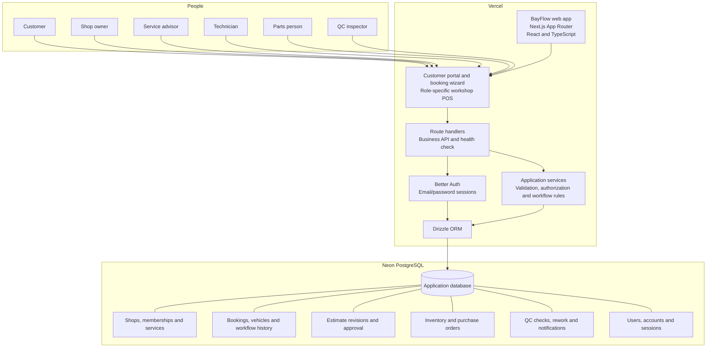
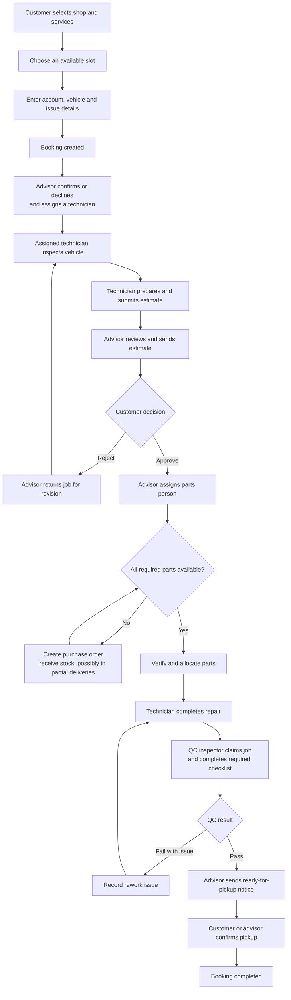

# BayFlow Studio — submission handoff

## Project links

- **Public GitHub repository:** [Eesar1/bayflow-studio](https://github.com/Eesar1/bayflow-studio)
- **Live application:** [https://bayflow-studio.vercel.app/](https://bayflow-studio.vercel.app/)
- **Application health check:** [https://bayflow-studio.vercel.app/api/health](https://bayflow-studio.vercel.app/api/health)
- **Project brief:** [BayFlow Hackathon Brief](reference/BayFlow-Hackathon-Brief.pdf)
- **Setup, demo accounts and test commands:** [README](../README.md)
- **Role-by-role demo steps:** [Demo walkthrough](DEMO-WALKTHROUGH.md)
- **Requirements coverage:** [Requirements](REQUIREMENTS.md)
- **Verification notes:** [Verification](VERIFICATION.md)

The production database is hosted on Neon PostgreSQL. The live health endpoint, public site, workshop slot lookup, owner sign-in and authenticated owner dashboard have been checked. The six PostgreSQL acceptance scenarios pass locally, including workflow transitions, tenant isolation and concurrency checks. The entire multi-role lifecycle has not been manually replayed on the production site.

## Architecture

## Booking-to-completion workflow

The application enforces role, assignment, shop-membership and workflow rules on the server. Database transactions protect slot capacity, stock allocation and QC job claims. See [Architecture](ARCHITECTURE.md) for additional implementation details.

## Submission checklist

- [x] Public GitHub repository
- [x] Live deployed URL with seeded demo accounts and records
- [x] Root README with setup, tests, demo accounts and architecture notes
- [x] Root `.env.example` with placeholders; real environment secrets are not included
- [x] Architecture and booking workflow diagrams
- [ ] Record and attach the short demo video (you will create this)

Calling, AI Front Desk, payments, email/SMS and PDF invoices are optional in the brief and are not part of this submission.
